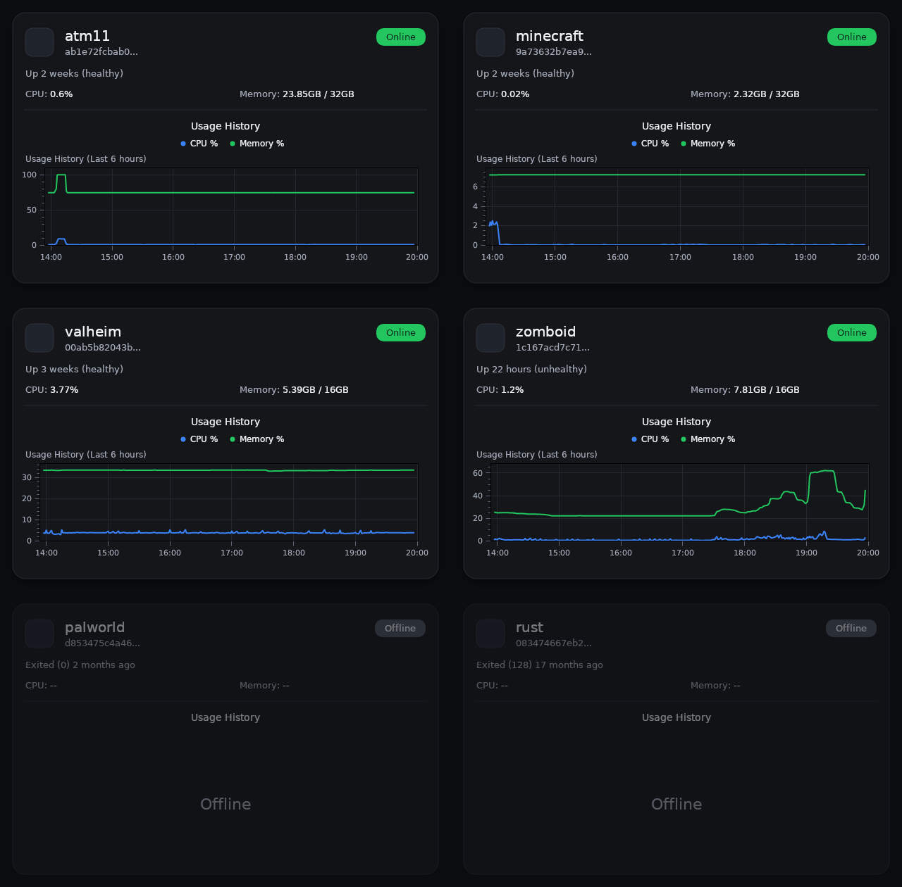

# dn-norsworthy-discord-status

A small service that shows the state of my game servers in Discord, so people in the server can see what is up without me exposing the monitoring API or its website.

## End goal

One Discord message that always shows the current status of every game server I choose to publish, kept fresh automatically, plus an image URL that can be embedded anywhere.

**Who it is for:** players in my Discord who want to know whether a server is up and how busy it is, and me, as a no-effort status board.

**Feature set (finished product):**

- One PNG grid with a tile per whitelisted game server: name, short id, online/offline pill, uptime and health, current CPU and memory, and a 6-hour CPU/memory history graph.
- Offline servers stay in the grid as dimmed tiles, so a stopped server is visible rather than missing.
- A Discord webhook message that is posted once and then edited in place every 5 minutes (a deleted message is re-posted automatically).
- `GET /status.png` serves the same grid (cached for 60 seconds); `GET /status.png?container=<name>` serves one server's card.
- Only whitelisted containers are ever shown; nothing else the monitor knows about can be read through this service.
- `GET /health` for container health checks.
- Shipped as a container image built and scanned in CI (`ghcr.io/brandonnorsworthy/dn-norsworthy-discord-status`), deployed from the `stacks` repo through Arcane.

What it looks like (the grid posted to Discord):



## Phases

Phases 0 to 2 are done; no later phase has been started.

- **Phase 0: single cycling card.** Done. One card at a time, rotating through the whitelisted servers.
- **Phase 1: one grid of all whitelisted servers.** Done. One image with a tile per server, CPU/RAM and history graph, offline servers shown dimmed, a fallback card when the monitor is unreachable, unit tests.
- **Phase 2: public-repo standard and deployment.** Done (1.0.0, deployed 2026-11-15). .NET 10, locked restores, warnings as errors, format check, CI/CodeQL/release workflows, Dependabot, version hooks, non-root image with `/health` and a built-in healthcheck, single-card endpoint limited to the whitelist, image published to GHCR, then deployed from the `stacks` repo through Arcane.
- **Later (ideas only, not started, not confirmed):**
  - A per-game icon in each tile's icon badge.
  - Player counts per server, if the monitor can provide them.

## How it works

Every 5 minutes the service asks the monitor API for all container stats (`GET /api/containers/stats/`), keeps only the whitelisted containers, fetches 6 hours of history for the online ones (`GET /api/containers/stats/{id}?h=6`, at most 4 at a time), renders the grid with SkiaSharp and OxyPlot, and edits the Discord message with the new image. The id of that message is kept in `/app/data/message-id.txt`.

Tile order: online servers first, then offline, each alphabetical. Layout: 1 column for one server, 2 columns for up to 6, 3 columns for 7 or more. If the monitor is unreachable or no whitelisted container exists, a single "All servers offline" card is shown instead.

## Configuration

All configuration comes from environment variables, supplied at deploy time (the compose file in the `stacks` repo). See `.env.example`.

| Setting | Required | Description |
|---|---|---|
| `BASE_URL` | yes | Base URL of the monitor API, e.g. `http://monitor:3000`. |
| `CONTAINER_WHITELIST` | yes | Comma-separated containers to show, e.g. `minecraft,valheim`. Each entry matches a container name exactly (case-insensitive) or a container id prefix. |
| `DISCORD_WEBHOOK_URL` | yes | The Discord webhook to post and edit the status message with. This is a secret. |
| Data directory | | `/app/data`, holds `message-id.txt`. Mount a volume here so the same message keeps being edited across restarts. It is the only place the app writes (besides `/tmp`). |
| Port | | `8080`, .NET's default container port. The compose file maps it to whatever host port it wants. |

## Endpoints

| Endpoint | Returns |
|---|---|
| `GET /health` | `200 Healthy` while the process is up. Does not call the monitor. |
| `GET /status.png` | The grid of all whitelisted servers (PNG, cached 60 s). |
| `GET /status.png?container=<selector>` | One server's card (640x420 PNG). The selector is a name or id prefix of a **whitelisted** container; anything else returns `404`. |

## Running the image

The compose file for this service lives in the `stacks` repo, not here. The image runs as the non-root `app` user (UID 1654) by default and also works with any `--user`, as long as `/app/data` is writable by that user (bind-mount a directory owned by it).

Health check, for the compose file (no curl in the image; the app probes itself):

```yaml
healthcheck:
  test: ["CMD", "dotnet", "/app/StatusImageCard.dll", "healthcheck"]
```

It GETs `http://127.0.0.1:8080/health` and exits 0 when healthy, 1 otherwise. The image also declares this as its Docker `HEALTHCHECK`.

Example run, as a stack would run it:

```bash
docker run --rm --user 10013:65534 -p 127.0.0.1:3500:8080 \
  --env-file .env -v "$PWD/data:/app/data" \
  ghcr.io/brandonnorsworthy/dn-norsworthy-discord-status:<version>
```

**The image never contains a `.env` file or any secret.** `.dockerignore` keeps `.env` out of the build context; configuration is passed in at run time.

## Development

No .NET SDK is needed on the host; everything runs in containers. The tests draw text, so the SDK container needs fontconfig and a font:

```bash
# One-off: an SDK image with fontconfig and a font for the rendering tests
printf 'FROM mcr.microsoft.com/dotnet/sdk:10.0\nRUN apt-get update && apt-get install -y --no-install-recommends libfontconfig1 fonts-dejavu-core && rm -rf /var/lib/apt/lists/*\n' \
  | docker build -t statuscard-sdk:local -

# Restore (locked), build (warnings as errors), format check, tests
docker run --rm --user "$(id -u):$(id -g)" -e HOME=/tmp -v "$PWD:/src" -w /src statuscard-sdk:local bash -c '
  dotnet restore dn-norsworthy-discord-status.sln --locked-mode &&
  dotnet build dn-norsworthy-discord-status.sln -c Release --no-restore -warnaserror &&
  dotnet format --verify-no-changes dn-norsworthy-discord-status.sln &&
  dotnet test dn-norsworthy-discord-status.sln -c Release --no-build'

# Build and run the image locally
docker build -t statuscard:dev .
docker run --rm -p 127.0.0.1:3500:8080 --env-file .env -v "$PWD/data:/app/data" statuscard:dev
# then open http://127.0.0.1:3500/status.png
```

Copy `.env.example` to `.env` and fill it in for local runs (`.env` is gitignored). Use a test webhook, not the production one. With a .NET 10 SDK installed you can also `dotnet run`, which loads `.env` and listens on `http://localhost:8080`.

Dependencies are pinned by the committed `packages.lock.json` files. After changing a package reference, run `dotnet restore` (without `--locked-mode`) and commit the updated lock files.

## Versioning and releases

The version lives in `<Version>` in `StatusImageCard.csproj` and is bumped by the git hooks in `.githooks/` from the commit message: `feat!:` (or `BREAKING CHANGE:`) major, `feat:` minor, any other commit that changes code patch; commits that only touch docs, `.github/`, `.githooks/`, `.gitignore` or `Assets/` don't bump. Turn the hooks on once per clone:

```bash
git config core.hooksPath .githooks
```

CI fails a pull request that changes code without changing the version.

Every push to `main` publishes `ghcr.io/brandonnorsworthy/dn-norsworthy-discord-status:latest` and `:sha-<short>`. To release, tag a green `main` commit with the version it already carries (`vX.Y.Z`); that publishes `:X.Y.Z`. The release workflow fails if the tag does not match the version in the project file. Stacks pin a version tag, never `latest`.
